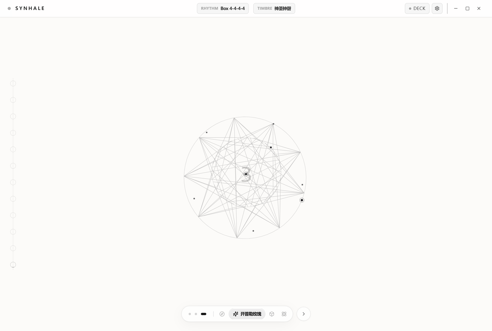
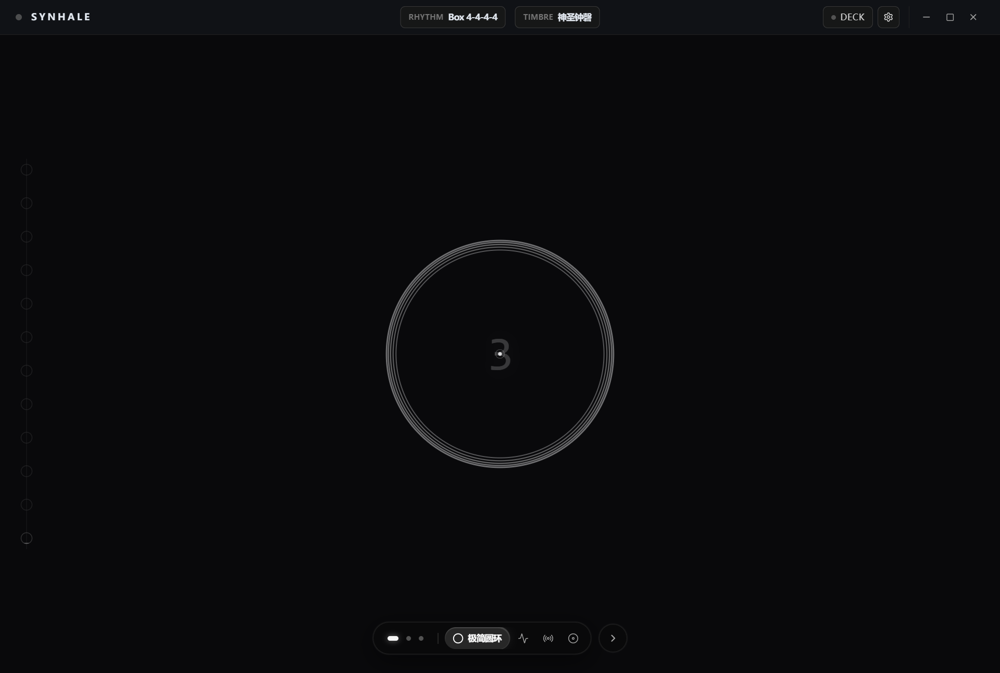
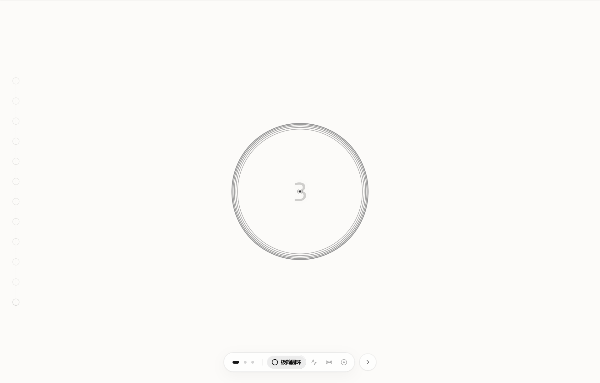
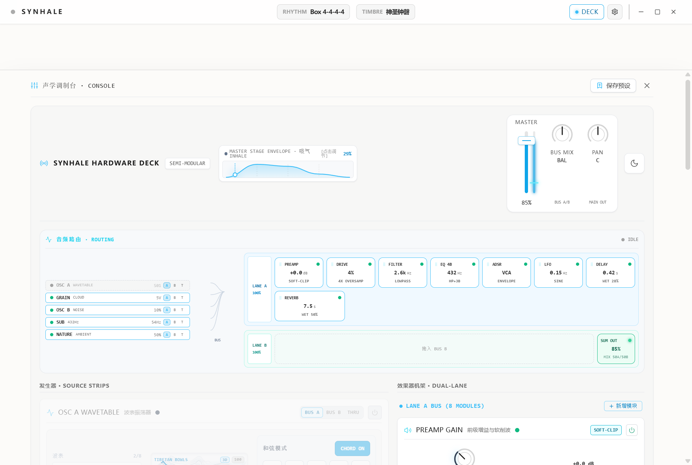
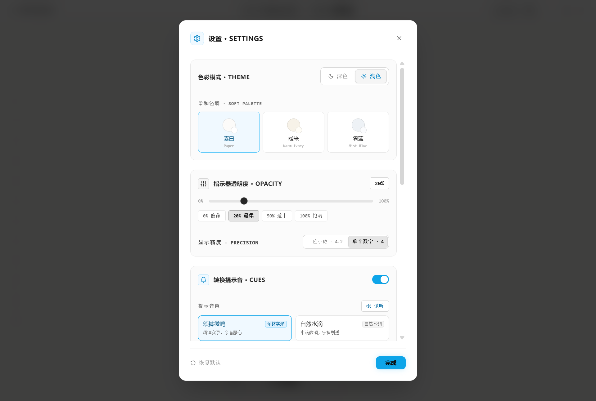

<div align="center">


# Synhale

**半模块化呼吸声疗数字合成器** · A Semi-Modular Breath Synthesizer

呼吸的生物节律，与现代合成器的声音纹理，在此共生。

[下载最新版](https://github.com/met-tk/Synhale/releases/latest) · [核心特性](#核心特性) · [从源码运行](#从源码运行)

</div>

---



Synhale 是一件桌面乐器：呼吸引擎驱动声音与光影随节律起伏，四大独立声源经插槽式效果链汇入双 BUS 混音；同一台机器，既是严肃的半模块化合成器，也是沉浸式呼吸声疗仪器。内置呼吸状态机提供 Box 4-4-4-4 等多种节律引导，实录呼吸提示音与 12 套声疗预设开箱即用。

## 界面一览

深色主题下的同一舞台：



八套纯单色光学呼吸动效，屏息阶段时间流速放缓，悬停之际禅意渐生：



声学调制台 Console，从底部滑出的深色玻璃拟态控制舱：



呼吸节律、提示音色、动效与主题，尽在设置弹窗：



## 核心特性

**声源机架**

- OSC A：Serum 级 12-TET 音乐调谐，乒乓交替双振荡波表，4-Voice 立体声和弦引擎，PWM / Sync / Bend / Mirror 四倍过采样塑形
- Granular Cloud：17 款声学与物理建模采样，本地音频拖拽导入，倒吸包络与微粒功率补偿
- OSC B 与 Sub Drone：独立的发生、调谐与推子
- Ambient：120 款分类环境声景

**效果链与混音**

- Filter / Drive / EQ / Delay / Reverb / Dual LFO 等插槽式效果机架，拖拽实时重排
- 双 BUS 等功率交叉混音，3ms 微淡出调度，热插拔零爆音
- 全链路 setTargetAtTime 声学防爆音，极端调制下无咔嗒

**呼吸引擎**

- 呼吸状态机节律引导（Box 4-4-4-4、4-4-6-2 等多种节奏与自定义）
- 高保真实录呼吸提示音，极端场景纯合成平滑降级
- 12 套声疗预设，运行态切换平滑重新触发

**视觉舞台**

- 八套 100% 独立设计语言的纯单色呼吸动效
- 周期念珠与中心呼吸指示器，随节律明灭
- 零 Emoji 工业美学，冷灰、科技天蓝与极光青主色调

**桌面端**

- Electron 无边框一体化硬件机架外壳，后台与最小化状态下音频时钟零降频
- 浅色纸感与深色工作台双主题

## 下载与安装

前往 [Releases](https://github.com/met-tk/Synhale/releases/latest) 获取最新的 Windows 安装包：

| 文件 | 说明 |
| --- | --- |
| `Synhale-Setup-x.y.z.exe` | 标准安装版，支持自选安装目录与快捷方式 |
| `Synhale-Portable-x.y.z.exe` | 绿色便携版，免安装直接运行 |

## 从源码运行

```bash
npm install
npm run dev            # 浏览器开发模式
npm run build          # 生产构建
npm test               # 全量测试
npm run electron:dist  # 打包 Windows 安装版与便携版
```

桌面端开发（`npm run electron:dev`）加载 `dist/` 产物，需先执行一次 `npm run build`。

## 技术架构

- 纯原生 Web Audio API 构建 DSP 全链路，不依赖第三方音频黑盒
- React 19 + TypeScript + Vite 6 + Tailwind CSS
- Electron 44 桌面运行时，electron-builder 出包
- 工程质量：147 套测试 / 1179 个用例 100% 通过，参数安全加固与存储校验全覆盖

---

<div align="center">

Crafted by [met-tk](https://github.com/met-tk)

</div>
